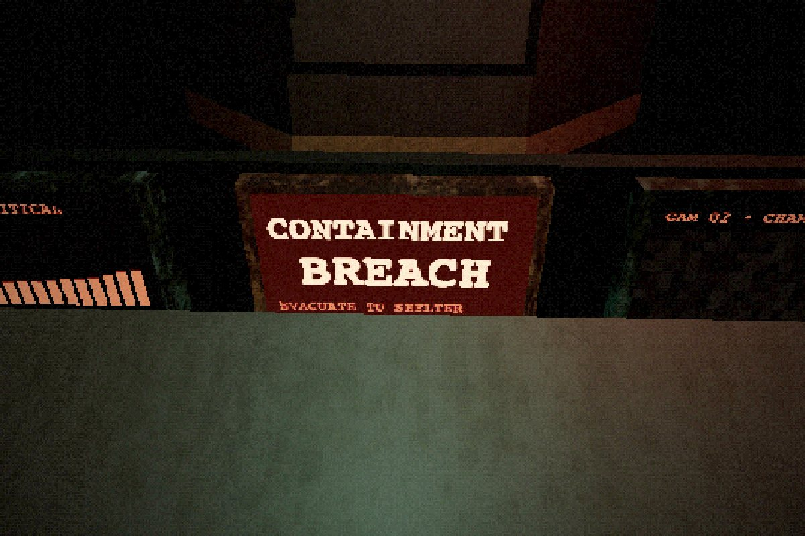
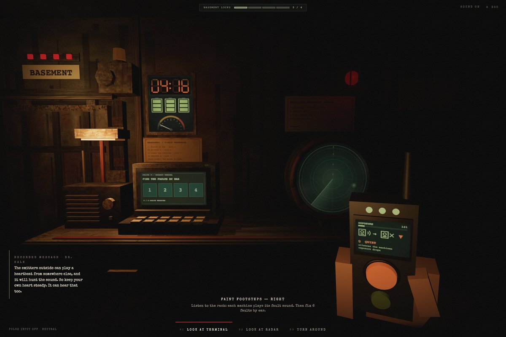
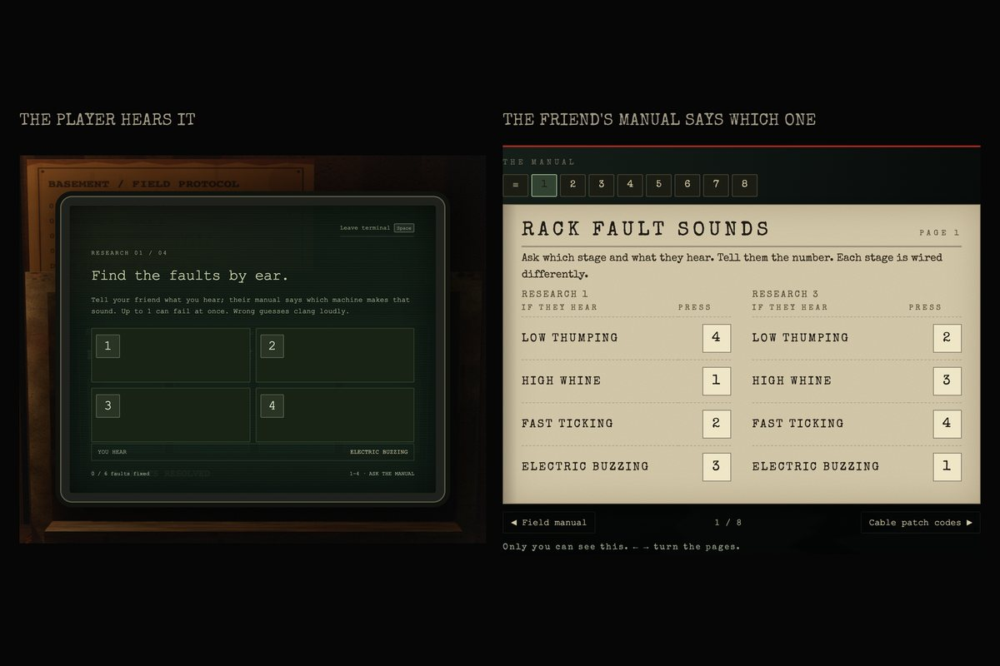
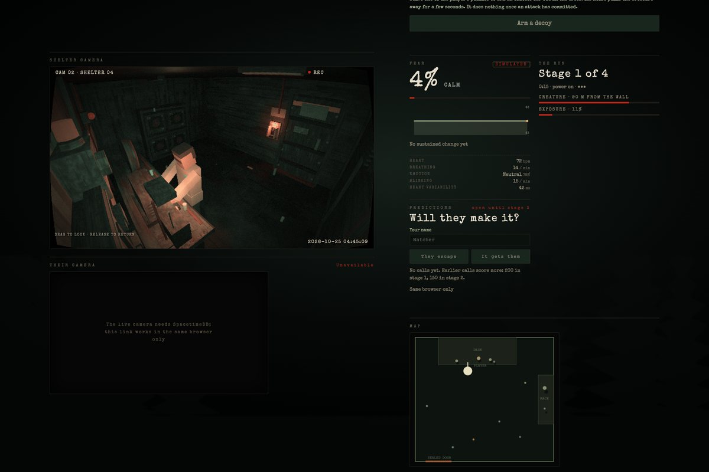

# HUSH

**A first-person horror game you play with your face.** You are sealed in a research shelter while something blind hunts outside it by sound. Your webcam reads your pulse, breathing and fear, and the thing outside can hear all of it.

Built at CalHacks 13.0 with React, Three.js, Electron, Gemini, ElevenLabs, Presage and SpacetimeDB.

| | |
| --- | --- |
|  |  |
|  |  |

## The game

The containment tube fails, you run for the emergency shelter, and the door seals behind you. A recorded message from the station director explains the rules: the specimen is nearly blind but hears everything. The only way out is the basement, whose door has four locks. Each research protocol on the terminal releases one. You have **five minutes** before the sedative wears off.

- **Everything you do makes noise.** Running machines, wrong answers and the door motor all raise your exposure. There is no alarm and no countdown: you hear its footsteps get louder and quicker, from the direction it is in, and it pounds on the wall when it is there.
- **Go quiet in time.** Pull the lever (Q) to silence the machines and let it lose interest, then bring the power back (hold F) once the steps fade. You have three isolation cells, and get one back per completed stage. Once it commits at the wall, it is too late.
- **Your body is an input.** With the camera on, Presage estimates your pulse, breathing and facial fear. A racing heart makes the heartbeat mask and the calm hold harder, and calming down makes it lose your trail. These are camera estimates for a game, never medical readings, and the game plays fine without a camera.

| Stage | Puzzles (order shuffled per run) | Releases |
| --- | --- | --- |
| 1 | Find 6 faults by ear (the rack key plays each machine's sound once) · patch 6 cables · rotate the conduit | Lock 1 |
| 2 | Repeat a growing signal sequence (3 → 5) · tap along to mask your heartbeat · transmit the lure to emitter A | Lock 2 |
| 3 | 8 faults by ear, two at a time, with a new sound key · 12 cables · mark it on the sonar three times | Lock 3 |
| 4 | A longer sequence (4 → 6) · breathe with the calm pacer until it loses your trail · emitter B | Lock 4 |
| Final | Send the last decoy and start the (loud) basement door motor | The ending |

## Ways to play

- **Begin with tutorial:** seven guided practice cards, read aloud by the radio, with the threat paused. The real run follows.
- **Skip tutorial & start:** straight into a run. A session's first run opens with Dr. Hale's recorded briefing.
- **Play with a friend:** send a link and your friend becomes your lifeline. Co-op is asymmetric: they hold an eight-page field manual you cannot see (fault sounds, cable codes, conduit boards, signal symbols, radar keys, the breathing pacer, the heartbeat mask, the door key), so you describe what you hear and they tell you what to press. Neither of you can finish alone. They can also flash a warning lamp in your shelter, fire decoys far out in the trees, and talk to you over optional voice chat.
- **Spectate:** anyone with the link watches live, read only: a shelter camera rebuilt from the game (your researcher at their station), the creature's distance, a map with physics props, key moments, predictions, your optional webcam and, only if you allow it, one live **FEAR** reading with your heart rate, breathing, expression, blink rate and heart-rate variability under it.

## Controls

| Key | Action |
| --- | --- |
| Click equipment / **E** | Use the terminal, the sonar monitor or the lever |
| **Space** | Step back from the equipment |
| **1–4** | Answer the current task (faults, conduit, heartbeat taps, memory, sonar marks) |
| **T** | Transmit a lure, engage the conduit, or start the door motor |
| **R** | Replay the signal sequence (free, but it costs time) |
| Drag a cable, or select cable then socket | Patch the relay |
| **Q** | Isolate the equipment (one cell) |
| Hold **F** | Restore power (from 4 s into an isolation; it restores itself at 25 s) |
| Hold **B** | Breathe in with the calm pacer; release to breathe out |
| Station buttons / drag | Face the terminal, the sonar or the lever; look around |
| **Esc** | Pause. **Settings** there turns on captions (off by default), reduced motion and softer scares; fixed memory tempo is under Operator settings on the start screen |

## Run it

```sh
git clone https://github.com/samerrahman/CalHacks-13.0.git
cd CalHacks-13.0
npm ci
cp .env.example .env.local   # optional provider keys; never commit
npm run dev                  # http://127.0.0.1:5173
```

The dev server reads `.env` / `.env.local` only at startup, so restart `npm run dev` after changing keys. Without keys the game still runs: the director falls back to its seeded rules and spoken lines fall back to captions.

```sh
npm run desktop       # build and launch the Electron app (native Presage camera, providers)
npm run check         # typecheck, all tests, web and Electron builds
npm run spacetime:generate   # regenerate client bindings after a module schema change
npm run cutscene -- render   # re-render the opening film (see cutscene/README.md)
```

Verified on macOS (Apple Silicon), Node 22 and Electron 45. WebGL and Web Audio are required. The desktop app uses Presage's native SDK; the browser build estimates pulse from the camera itself.

## How it is built

| Part | What it does |
| --- | --- |
| `src/game/` | The deterministic game: a fixed-step reducer owns time, the creature, puzzles, danger and the deadline. Nothing waits on the network, and every AI proposal is revalidated here. |
| `src/render/`, `src/ui/` | Three.js renders the sealed shelter; React draws the terminal panels, HUD, menus, spectator page and run report. |
| `src/audio/` | Web Audio engine: positional footsteps, machine faults, scares and the speech queue. |
| `src/sensing/` | Presage camera input (native in Electron, optical estimate in the browser): pulse, breathing, expressions, a frozen baseline and a sustained trend. |
| `src/integrations/` + `electron/` | Gemini picks bounded creature tactics and writes monster taunts from public events; ElevenLabs voices the monster and the British radio ("Daniel"). Keys stay in the Electron main process or the loopback dev server. |
| `spacetimedb/` | The multiplayer backend on SpacetimeDB Maincloud (database `scary-5zsk8`): private sessions with a 24-hour expiry, the spectator trace, server-side prop physics, consented vitals, WebRTC signalling for the webcam and voice, the co-op manual and friend actions, and predictions. All access uses per-run capabilities. Without it, everything still works in the same browser over BroadcastChannel. |
| `cutscene/`, `src/cutscene/` | The opening and ending films, rendered offline from Three.js scenes with their own soundtrack (`tools/cutscene.mjs`). |

## Privacy

Camera frames never leave the device. Spectators get nothing about your body unless you tick the vitals consent, and then only whole-number summaries and one fear percentage, never waveforms or recordings. Live video goes peer to peer, only while you share it. Shared sessions are deleted when you stop sharing or after 24 hours. Provider keys live in ignored `.env` files, read only by the Electron main process or the loopback dev server. See [SPECTATE](docs/SPECTATE.md) and [CAMERA](docs/CAMERA.md).

## More docs

[Co-op](docs/COOP.md) · [Spectating](docs/SPECTATE.md) · [Live camera](docs/CAMERA.md) · [Prop physics](docs/PHYSICS.md) · [Balance and tuning](docs/BALANCE.md) · [Assets and licences](docs/ASSETS.md) · [Cutscenes](cutscene/README.md) · [Integration status](docs/INTEGRATION_STATUS.md) · [Verification handoff](docs/HANDOFF.md) · [Demo script](docs/DEMO.md) · [Team workflow](docs/TEAM.md)

## Team

**Samer** (signals and platform: camera sensing, Electron, SpacetimeDB) · **James** (gameplay and integration) · **Lea** (art, audio and UI) · **Lucy** (AI, voice and pitch)

The older NIGHT RELAY and LOCK IN build kits remain under `lock-in-kit/` and `night-relay-kit/` as design references only; `convex/` is historical.
